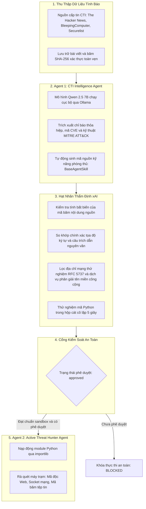

# BẢN ĐẶC TẢ KỸ THUẬT DỰ ÁN
## HỆ THỐNG CTI AGENT ĐA TÁC NHÂN KẾT HỢP ACTIVE THREAT HUNTER VỚI EXPLAINABLE AI

- Tên dự án: Autonomous Cyber Threat Intelligence Framework
- Kiến trúc: Đa tác nhân cộng tác với hai động cơ chuyên biệt
- Cơ chế kiểm định: Explainable AI kết hợp cổng an toàn kỹ năng
- Định hướng kiến trúc: Chuyên biệt hóa đầu ra duy nhất là kỹ năng phòng thủ tự hành

---

## 1. BÀI TOÁN VÀ ĐỊNH HƯỚNG KIẾN TRÚC

### 1.1. Khó khăn thực tế trong xử lý tình báo an ninh mạng
- Quá tải thông tin: Số lượng bài báo phân tích lỗ hổng và mã độc xuất bản mỗi ngày vượt quá khả năng xử lý thủ công.
- Độ trễ chuyển giao: Thời gian từ lúc phát hiện mối đe dọa đến khi lập trình xong kịch bản kiểm tra máy trạm thường kéo dài nhiều ngày.
- Hiện tượng ảo giác của mô hình ngôn ngữ lớn: Trí tuệ nhân tạo có thể tự suy diễn sai lệch địa chỉ mạng hoặc gán nhầm kỹ thuật tấn công.
- Phân tán tài nguyên: Việc cố gắng tích hợp đồng thời nhiều hệ thống quản lý sự kiện an ninh thông tin bên ngoài làm tăng độ phụ thuộc hạ tầng và gây gián đoạn luồng vận hành.

### 1.2. Giải pháp kiến trúc đầu ra duy nhất
Hệ thống loại bỏ hoàn toàn việc đồng bộ danh sách chỉ báo sang các hệ thống cảnh báo tĩnh bên ngoài. Toàn bộ chu trình vận hành hội tụ vào một đầu ra duy nhất: **Kỹ năng phòng thủ tự hành viết bằng mã nguồn Python**.

---

## 2. KIẾN TRÚC HAI ĐỘNG CƠ TỰ HÀNH

Hệ thống phân định ranh giới rõ ràng giữa tác vụ suy luận và tác vụ thực thi:

### 2.1. Động cơ phân tích tình báo: Agent 1
- File định nghĩa: `core/agent.py`
- Bản chất: Khối suy luận chiến lược sử dụng mô hình ngôn ngữ lớn Qwen 2.5 7B.
- Quy trình vận hành:
  - Thu thập bài viết tình báo, ghi nhận mã băm SHA-256 và mã trạng thái HTTP.
  - Bóc tách chỉ báo thỏa hiệp và liên kết hành vi với ma trận MITRE ATT&CK.
  - Tự động lập trình kỹ năng phòng thủ kế thừa từ lớp `BaseAgentSkill`. Kỹ năng này là một tệp Python độc lập được lưu tại thư mục `skills/generated/`.

### 2.2. Động cơ săn lùng mối đe dọa: Agent 2
- File định nghĩa: `core/hunter_agent.py`
- Bản chất: Khối thực thi mã lệnh Python thuần túy, không phụ thuộc vào mô hình ngôn ngữ lớn.
- Cơ chế nạp động: Sử dụng thư viện `importlib.util` để nạp mã nguồn kỹ năng vào bộ nhớ tiến trình khi có lệnh thực thi.
- Phạm vi tác chiến:
  - Lĩnh vực web: Duyệt đệ quy cây thư mục mã nguồn website, kiểm tra cú pháp Webshell như `eval`, `base64_decode`, `system`, hoặc chữ ký backdoor đã biết.
  - Lĩnh vực mạng: Kiểm toán socket mạng để phát hiện kết nối ngầm đến máy chủ điều khiển botnet.
  - Lĩnh vực máy trạm: Quét mã băm SHA-256 của các tệp tin thực thi trên hệ thống tệp.
- Cơ chế đồng bộ cắm là chạy: Khi sao chép dự án sang thiết bị mới, Agent 2 tự động phát hiện toàn bộ kỹ năng có sẵn trên đĩa cứng và đồng bộ vào cơ sở dữ liệu.

---

## 3. THẨM ĐỊNH NGUỒN GỐC VÀ BẰNG CHỨNG XAI

Module `validators/xai_verifier.py` vận hành độc lập để kiểm soát độ tin cậy của dữ liệu:

### 3.1. Xác thực nguồn gốc dữ liệu
- Lưu trữ các trường dữ liệu bắt buộc: `source_url`, `source_title`, `source_publisher`, `fetched_at`, `http_status`.
- Trường `content_hash` lưu mã băm SHA-256 của nội dung gốc. Mọi thay đổi đối với nội dung bài viết đều làm sai lệch mã băm và kích hoạt cảnh báo sai lệch dữ liệu.

### 3.2. Đối soát chỉ báo thỏa hiệp
- Phân loại so khớp chuỗi:
  - `exact_match`: Chuỗi xuất hiện nguyên vẹn trong bài viết.
  - `normalized_match`: Chuỗi khớp sau khi chuẩn hóa dạng phòng thủ như đổi `1[.]1[.]1[.]1` thành `1.1.1.1`.
  - `not_found`: Chuỗi hoàn toàn không có trong nội dung nguồn.
- Tọa độ ký tự và trích dẫn:
  - Xác định vị trí ký tự bắt đầu và kết thúc `[char_offset_start..char_offset_end]`.
  - Trích xuất câu văn ngữ cảnh trực tiếp từ dữ liệu thô, không cho phép mô hình ngôn ngữ tự viết lại câu trích dẫn.
- Lọc địa chỉ lành tính và địa chỉ thử nghiệm:
  - Địa chỉ thuộc dải thử nghiệm RFC 5737 hoặc mạng riêng RFC 1918 được phân loại `example_or_benign`.
  - Địa chỉ máy chủ tên miền công cộng như 8.8.8.8 được phân loại `mentioned_not_confirmed`.
  - Chỉ phân loại `maliciousness_confirmed` khi ngữ cảnh xuất hiện từ khóa xác nhận máy chủ độc hại hoặc mã độc thực tế.

### 3.3. Kiểm tra bằng chứng kỹ thuật MITRE ATT&CK
Nhận định về kỹ thuật tấn công chỉ được công nhận khi có động từ chỉ hành vi cụ thể như `executed`, `injected`, `downloaded`, `established`, `exploited`. Khi thiếu bằng chứng ngữ cảnh, hệ thống phân loại `insufficient_evidence`.

### 3.4. Công thức tính điểm tin cậy
Điểm tin cậy được tính theo công thức trọng số:

$$\text{Trust Score} = 0.35 \cdot S_{\text{match}} + 0.35 \cdot S_{\text{evidence}} + 0.15 \cdot S_{\text{cross\_check}} + 0.15 \cdot S_{\text{freshness}}$$

---

## 4. CỔNG AN TOÀN DUY NHẤT CHO KỸ NĂNG TỰ HÀNH

Hệ thống tập trung kiểm soát tại một cổng an toàn duy nhất trước khi đưa kỹ năng vào hoạt động:

### 4.1. Kiểm thử cú pháp tự động
- Khi Agent 1 tạo ra tệp Python mới, tệp này được đưa vào tiến trình con độc lập để kiểm tra cú pháp trong thời hạn 5 giây.
- Kỹ năng có lỗi cú pháp bị đánh dấu `syntax_error` và từ chối lưu trữ.

### 4.2. Khóa thực thi an toàn
- Mọi kỹ năng mới khởi tạo đều mang trạng thái `pending_review`.
- Khi chuyên viên chưa phê duyệt, Agent 2 lập tức chặn lệnh thực thi và trả về trạng thái `BLOCKED`.
- Chỉ khi chuyên viên bấm phê duyệt trên giao diện hoặc gửi yêu cầu API hợp lệ, kỹ năng mới chuyển sang `approved` và được phép quét máy trạm.

---

## 5. CẤU TRÚC LƯU TRỮ CƠ SỞ DỮ LIỆU

Hệ thống sử dụng SQLite với chế độ ghi nhật ký trước WAL để tối ưu truy xuất đồng thời:

| Bảng cơ sở dữ liệu | Mục đích lưu trữ |
| :--- | :--- |
| `cti_reports` | Báo cáo tình báo, mã băm SHA-256 và trạng thái HTTP. |
| `extracted_iocs` | Chỉ báo thỏa hiệp, điểm tin cậy và trạng thái phê duyệt. |
| `evidence_records` | Tọa độ ký tự, câu trích dẫn nguyên văn và mã băm đoạn trích. |
| `ioc_verifications` | Kết quả đối soát chuỗi và đánh giá ngữ cảnh độc hại. |
| `claim_verifications` | Bằng chứng hành vi đối với kỹ thuật MITRE ATT&CK và mã CVE. |
| `agent_skills` | Mã nguồn kỹ năng Python do Agent 1 lập trình cho Agent 2. |
| `skill_verification_runs` | Nhật ký chạy thử nghiệm hộp cát và liên kết nguồn dữ liệu. |
| `approval_records` | Lịch sử phê duyệt hoặc từ chối của chuyên viên. |

---

## 6. GIAO DIỆN BÀN LÀM VIỆC CHUYÊN VIÊN AN NINH

Giao diện được xây dựng trên nền tảng FastAPI kết hợp HTML5:
- Màn hình tổng quan: Biểu đồ phân bổ chỉ báo, số lượng kỹ năng đã sinh và ma trận MITRE ATT&CK.
- Tab thẩm định nguồn gốc xAI: Bảng đối soát từng ký tự, trích dẫn văn bản gốc và các nút phê duyệt trực tiếp.
- Bàn điều khiển Agent 2:
  - Danh mục kỹ năng kèm nút xem trực tiếp mã nguồn Python trước khi kích hoạt.
  - Bộ chọn thư mục mục tiêu hỗ trợ đường dẫn mặc định và đường dẫn tùy chỉnh trên máy tính.
  - Màn hình nhật ký Telemetry màu đen hiển thị trực tiếp tiến trình quét tệp tin, dòng mã phát hiện và thông báo cảnh báo.

---

## 7. KẾT QUẢ KIỂM THỬ THỰC TẾ

Toàn bộ 12 ca kiểm thử tự động tại tệp `tests/test_xai_verifier_e2e.py` đã đạt kết quả thành công:
- Ca 01: Khớp chính xác chỉ báo và xác nhận độc hại đạt trạng thái `verified` với điểm số 88%.
- Ca 02: Phát hiện chỉ báo không có trong bài viết đạt trạng thái `rejected` với điểm số 0%.
- Ca 03: Phân loại đúng địa chỉ IP thử nghiệm RFC 5737 đạt trạng thái `example_or_benign`.
- Ca 04: Nhận diện hạ tầng tên miền công cộng 8.8.8.8 đạt trạng thái `mentioned_not_confirmed`.
- Ca 05: Bài viết chỉ có mô tả hành vi đạt trạng thái kiểm chứng MITRE T1059 và không bịa đặt chỉ báo.
- Ca 06: Báo cáo gặp lỗi HTTP 404 được ghi nhận đúng mã lỗi kết nối.
- Ca 07: Sửa đổi nội dung bài viết gốc kích hoạt cảnh báo sai lệch mã băm.
- Ca 08: Kỹ thuật tấn công thiếu bằng chứng động từ hành vi bị từ chối công nhận.
- Ca 09: Kỹ năng thiếu mã định danh báo cáo nguồn bị đánh dấu chưa xác thực.
- Ca 10: Kỹ năng có lỗi cú pháp Python bị đánh dấu `syntax_error`.
- Ca 11: Agent 2 chặn đứng việc thực thi kỹ năng khi chưa có trạng thái `approved`.
- Ca 12: Bộ lọc kiểm soát dữ liệu ngăn chặn hoàn toàn việc chuyển tiếp chỉ báo thô chưa qua thẩm định.

---

## 8. NỘI DUNG THAM VẤN CỐ VẤN CHUYÊN MÔN

Bốn vấn đề kỹ thuật trọng tâm cần trao đổi cùng cố vấn Argon:
- Phương án đóng gói hộp cát cho Agent 2: Đánh giá việc sử dụng tiến trình con hiện tại so với việc cô lập bằng Docker container hoặc gVisor nhằm ngăn chặn rủi ro mã độc tấn công ngược Agent 2.
- Cơ chế kiểm thử ngữ nghĩa của kỹ năng tự sinh: Giải pháp tự động phân tích trừu tượng Abstract Syntax Tree để phát hiện các hàm Python nguy hiểm trước khi lưu kỹ năng vào đĩa cứng.
- Hiệu chuẩn bộ trọng số điểm tin cậy: Đề xuất tập dữ liệu đối sánh chuẩn để tối ưu hóa 4 hệ số thành phần trong công thức tính toán.
- Định dạng xuất bản kỹ năng dùng chung: Đánh giá khả năng đóng gói kỹ năng tự sinh thành gói thư viện tương thích với các nền tảng điều phối an ninh mở.

---

## 9. CÁC CẢI TIẾN ĐÃ TRIỂN KHAI (CẬP NHẬT)

### 9.1. Cổng chính sách tĩnh (AST Policy Gate) — đã thay cho đề xuất ở mục 8
Mới: `validators/skill_security.py`. Nguyên tắc **deny-by-default (allowlist)**:
- Chỉ import được các module cho phép; chặn `subprocess`, `shutil`, `pickle`, `importlib`, `requests`, `urllib.request` ...
- Chặn `eval`, `exec`, `compile`, `__import__`, `getattr/setattr` động.
- Chặn toàn bộ API nguy hiểm của `os` (`system`, `popen`, `exec*`, `remove`, `chmod`, `environ` ...), kể cả qua bí danh `import os as o`.
- Chặn mở file ở chế độ ghi (`w/a/x/+`) và mode không xác định.
- Chặn thao tác socket chủ động (`connect`, `send`, `bind`, `listen`) — kỹ năng chỉ được giám sát.
- Chặn truy cập thuộc tính dunder và `sys.modules`.
- **Mã vi phạm bị từ chối TRƯỚC KHI ghi file xuống đĩa**, ghi trạng thái `policy_violation`/`rejected` vào `skill_verification_runs` làm dấu vết kiểm toán.

### 9.2. 4 lớp kiểm soát tại điểm thực thi
1. **Không còn tự phê duyệt**: `_sync_disk_skills_to_db()` chỉ đăng ký skill từ đĩa ở trạng thái `pending_review` (bỏ cơ chế `System Bootstrapper` duyệt ngầm).
2. **Chống rửa phê duyệt**: khi `save_skill` ghi đè mã của skill đã tồn tại, `approval_status` tự reset về `pending_review`.
3. **Tái kiểm tra AST tại Hunter**: kể cả skill đã `approved`, mã vẫn được quét lại trước khi `importlib` nạp vào; vi phạm trả về `BLOCKED`.
4. **Báo cáo trung thực**: kỹ năng không nạp được instance hợp lệ trả về `error`, không còn giả báo `success`.

### 9.3. Hộp cát được làm cứng
Subprocess chạy `python -I -B` (isolated mode), `env` tối thiểu (chỉ `SYSTEMROOT`/`PATH`), `cwd` là thư mục tạm riêng, timeout 5 giây.

### 9.4. An toàn API
- CORS đổi từ `*` sang danh sách nguồn cục bộ.
- Middleware chặn request có `Host` không phải localhost (chống DNS rebinding) và `POST` có `Origin` từ trang web khác (chống CSRF drive-by).
- Dọn tự động các run kẹt trạng thái `running` khi khởi động (đã xử lý 13 run kẹt trong lần chạy kiểm chứng).
- Bỏ route `/api/database` khai báo trùng lặp.

### 9.5. Vận hành
- Thêm `requirements.txt` và `.gitignore` ở thư mục gốc đồ án.
- Nhật ký thay bằng `logging` (logger `cti.hunter`, `cti.web`) thay cho `print`.

### 9.6. Kiểm thử
Bổ sung `tests/test_security_hardening.py` (13 ca): AST gate với 12 mẫu mã độc, skill từ đĩa không được tự duyệt, skill đã duyệt nhưng mã độc vẫn bị chặn, reset phê duyệt khi sinh lại mã, từ chối mã độc trước khi ghi file, API local-only, dọn run kẹt.
**Tổng số ca kiểm thử: 25 (12 + 13), toàn bộ PASS.**
